# Satisfeito

**English** | [Português](README.md)

> Simple, fast customer satisfaction surveys for local businesses: restaurants, snack bars and shops.

The customer scans a **QR code** on the table, the counter or the receipt, answers in under 30 seconds on their phone, and the business owner follows everything in a **dashboard** with averages, charts, a staff ranking and an **AI-written summary** of what customers are saying.

The first customer is the snack bar **Bebelu**. Later, the plan is to offer Satisfeito to other businesses.

**Live demo:** https://satisfeito.vercel.app

> 🚧 **Work in progress.** This README is updated after each finished stage.

> **Note:** the app itself (screens, buttons, messages) is in **Brazilian Portuguese**. UI names below appear in Portuguese with an English gloss where needed.

---

## How it works

**For the business (with login)**
- Creates an account and enters the dashboard
- Registers staff members (optional)
- Builds surveys with three question types:
  - **Score**: a 1 to 10 scale
  - **Text**: free answer
  - **Staff member**: "Quem te atendeu?" ("Who served you?")
- Generates the survey link and QR code
- Follows the results in the dashboard

**For the customer (no login)**
- Opens the survey from the QR code, answers and submits. Fast and designed for phones

**Dashboard**
- Average of each score question and its evolution over time
- Staff ranking by average score
- Number of answers today, this week and this month
- Recent answers
- Team report written by AI, ready to copy into WhatsApp: overview, praise, complaints, suggestions and actions

---

## Screens

| Home page | Sign in |
|---|---|
| 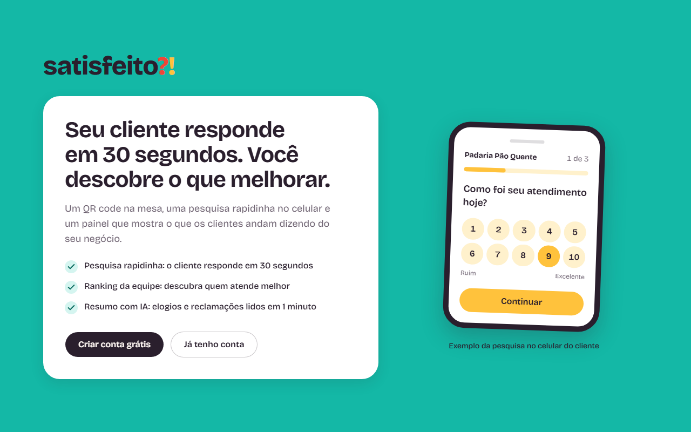 | 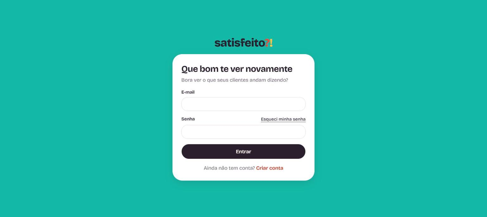 |

**Survey the customer answers on their phone** (opens from the QR code, no login):

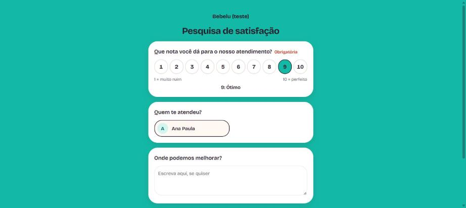

**Business dashboard** (with login):

| Staff (Funcionários) | Surveys (Pesquisas) |
|---|---|
| 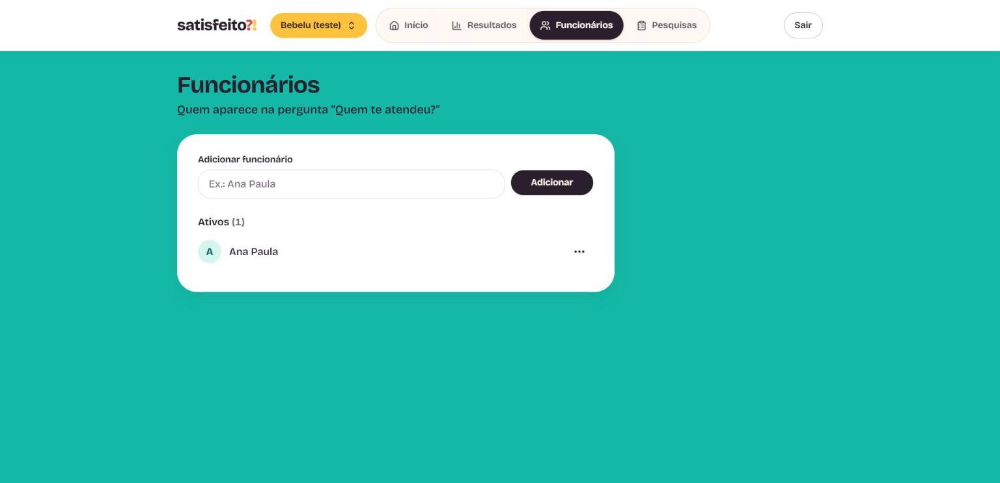 | 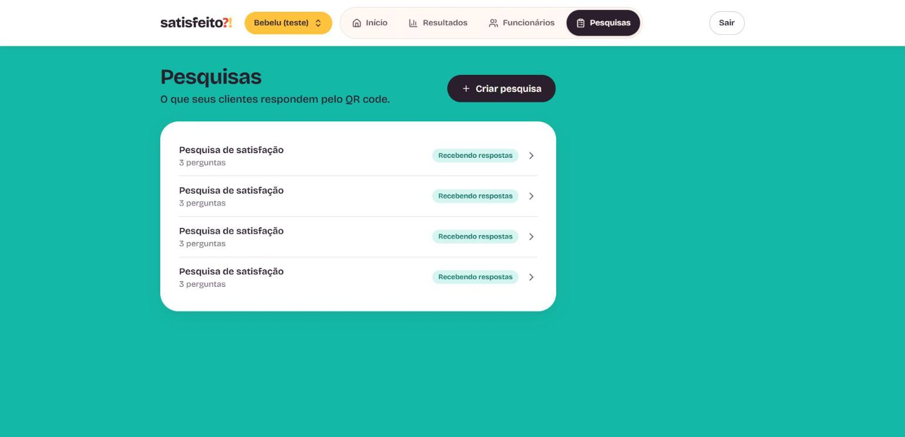 |

| Survey link and QR code | Survey questions |
|---|---|
| 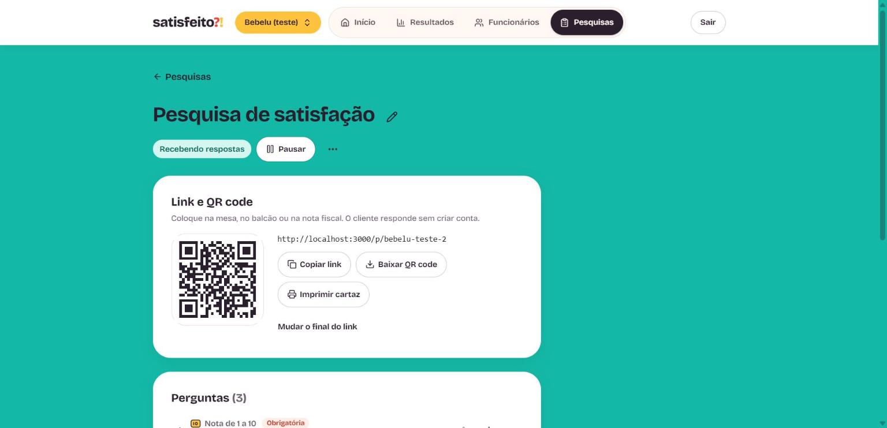 | 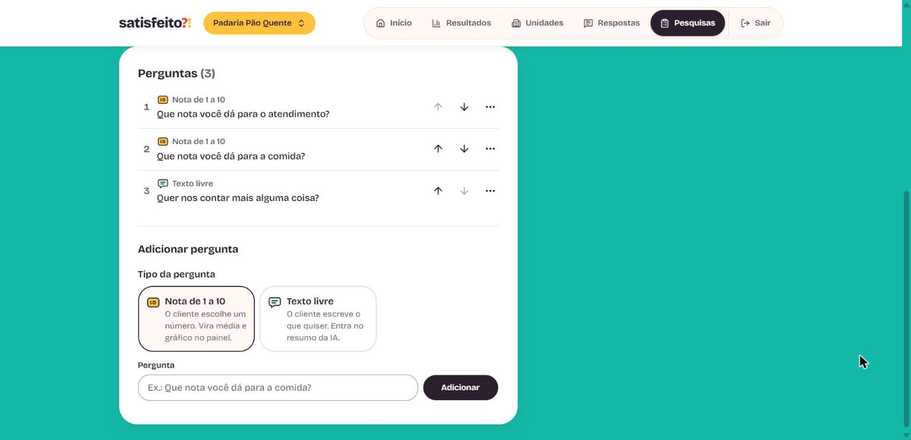 |

**Results** (7, 30 or 90-day period, comparison with the previous period, NPS, score distribution, highlights, weekday and shift, evolution and staff ranking):

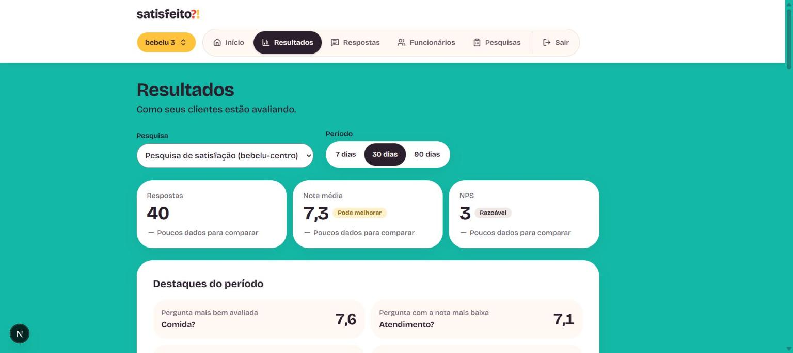

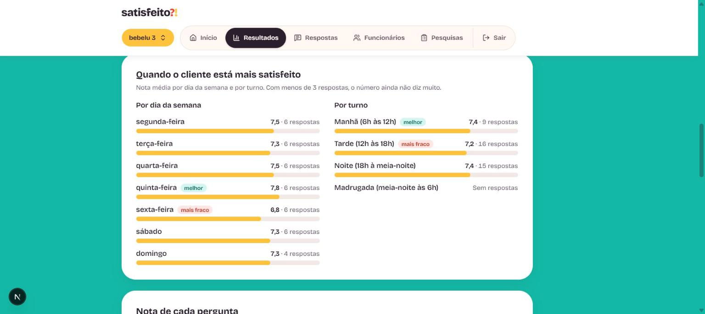

**More dashboard features**
- **Unidades** (units, `/painel/unidades`, only shown with more than one business): average score, answers and NPS of each business side by side, compared with the previous period
- **Baixar planilha (CSV)** (download spreadsheet) on the Answers page: opens straight in Excel (`;` separator), protected against formulas typed by customers
- **E-mail alerts** (card on the home page): low score and bad-score burst alerts, at most 1 every 30 minutes per survey and 10 per day per business; the e-mail never carries the customer's text. Uses Resend (`RESEND_API_KEY` and `EMAIL_REMETENTE`); off without the variables
- Friendly error page and server errors logged as JSON (no URL parameters) in the host logs
- CI on GitHub Actions: types, lint, tests, build and database security tests on a local Supabase, on every PR

**Answers** (All, Suspicious and Discarded tabs, suspicious badge and Discard button):

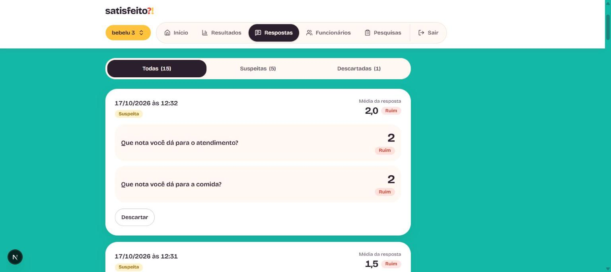

**Team report** (text ready to copy and send on WhatsApp):

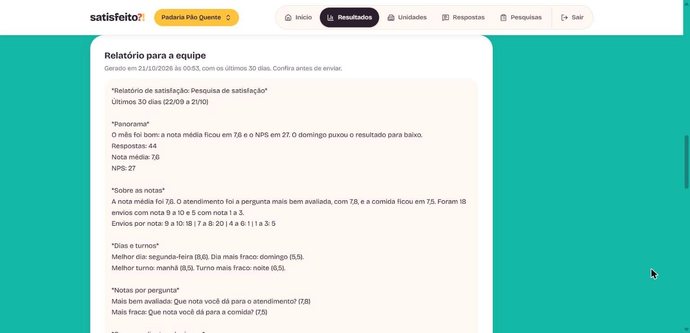

> The numbers in these screenshots are examples created only for the demo, and the AI text in the report was simulated (the real API was not called).

---

## Tech stack

| Layer | Technology |
|---|---|
| Framework | [Next.js 16](https://nextjs.org) (App Router) + React 19 |
| Language | TypeScript |
| Styling | Tailwind CSS 4 |
| Database and auth | [Supabase](https://supabase.com): Postgres + Auth, with RLS (Row Level Security) |
| Charts | [Recharts](https://recharts.org) |
| Anti-bot | [Cloudflare Turnstile](https://developers.cloudflare.com/turnstile/) (invisible, no IP used) |
| AI | [Claude](https://www.anthropic.com/claude) (Anthropic API, `@anthropic-ai/sdk`), called from the server only |

---

## Progress

- [x] **Stage 1**: project structure: Next.js + TypeScript + Tailwind and the Supabase connection
- [x] **Stage 2**: business sign-up and login
- [x] **Stage 3**: staff registration (and several businesses per login)
- [x] **Stage 4**: creating surveys and questions
- [x] **Stage 5A**: public survey page, link, QR code and printable poster
- [x] **Stage 5B**: bot protection (Cloudflare Turnstile) and the column used to discard answers
- [x] **Stage 6A**: Results: totals, score of each question, evolution and staff ranking
- [x] **Stage 6B**: answer list, "suspicious" answer badge and discarding
- [x] **Stage 7**: AI summary of the written answers (praise, complaints and suggestions)
- [x] **Stage 7B**: team report (AI + WhatsApp-ready text, with an option to name staff)
- [x] **Stage 6C**: full dashboard: 7, 30 or 90-day period, comparison with the previous period, NPS, score distribution, weekday and shift, highlights
- [ ] **Stage 8**: real-world test at Bebelu and adjustments

### What already exists

**Satisfeito visual identity**
- Coral, mango, mint, plum and cream palette; Bricolage Grotesque font; `?!` icon in the browser tab
- [shadcn/ui](https://ui.shadcn.com) (Radix) components adapted to the brand, with buttons and fields designed for touch on phones
- Custom SVG icons (no emojis)

**Business account**
- Home page with "Criar conta" (sign up) and "Entrar" (sign in)
- **Sign-up** on a single screen (business name, e-mail and password) with e-mail confirmation
- **Sign in**, **sign out** and **forgot password** (e-mail link, then a new password)
- Protected **dashboard** with the business greeting and first steps
- **Several businesses per login** (e.g. two branches): selector at the top of the dashboard and "Adicionar empresa" (add business)
- Error messages in Portuguese and forms that don't lose what was typed

**Staff**
- `/painel/funcionarios` page: add several in a row (the field stays focused), rename, deactivate, reactivate and delete with confirmation
- Unique name per business, case-insensitive ("Ana" and "ana" are the same), with a hint on how to tell them apart
- Inactive staff disappear from the survey, but their history is kept
- Works with keyboard and screen reader: focus is never lost, and errors and additions are announced

**Surveys**
- `/painel/pesquisas` page: list with each survey's state ("Recebendo respostas" / receiving answers, or "Pausada" / paused). Each item shows the end of the survey link, the number of questions and the answers received (discarded ones not counted), so surveys with the same title can be told apart
- Create a survey with suggested questions: one required score, "Quem te atendeu?" (only if the business has active staff) and a free comment
- Survey editor: editable title, Pause/Resume and Delete with confirmation
- Questions of 3 types (score, free text and "Quem te atendeu?"), each with its own icon: move up/down, make required/optional, edit the text, remove from the survey and bring it back later
- Limit of 10 questions and a single "Quem te atendeu?" per survey, also enforced in the database
- Warnings when the score question is missing ("sem nota") or when there is no staff for the staff question ("sem equipe")
- Works with keyboard and screen reader

**Results**
- `/painel/resultados` page: one survey at a time, with a selector when the business has more than one (the most recent survey with answers opens first)
- Period selector (7, 30 or 90 days, default 30; `?dias=` in the URL) and cards for answers, average score and NPS, each compared with the previous period ("poucos dados para comparar" / too little data to compare under 5 answers)
- NPS (only with 10 scored answers or more) and score distribution in 4 bands, always with a number, a percentage and a word
- Weekday and shift (morning, afternoon, evening, late night) with the average score of each; a cell with fewer than 3 answers is dimmed
- Highlights: best and weakest question, weakest day and who pleased customers most (shown only with enough data)
- Average score of each question, always with a number and a word ("Ótimo" / great, "Pode melhorar" / can improve, "Ruim" / poor), never color alone
- Chart of the average score per day over the chosen period (real time axis), with a hidden table for screen readers
- Staff ranking by the average score of the customers who picked each person; anyone with fewer than 3 ratings shows after the others, with a "poucas avaliações" (few ratings) tag
- Discarded answers count in no number; a survey without answers shows how to get the first one
- The numbers come from a database function (`painel_pesquisa`, `security invoker`), so RLS applies: each business only sees its own survey

**Answers, suspicious ones and discarding**
- `/painel/respostas` page: lists the answers of a survey, newest first, 20 per page, with tabs **Todas** (all), **Suspeitas** (suspicious) and **Descartadas** (discarded), each with its count
- Each answer shows date and time (São Paulo time), scores with number and word, free text and the person chosen in "Quem te atendeu?". Customer text is always shown as plain text
- **"Suspeita" badge:** an answer is bad when the average of its scores is 4 or less; 4 or more bad answers within 15 minutes, in the same survey, form a burst and all of them get the badge. The badge only warns: the owner decides. No IP or identification is used
- **Descartar** (discard) and **Restaurar** (restore) buttons (reversible) and, in the Suspicious tab, "Descartar as suspeitas desta página" (discard this page's suspicious answers). Discarding removes the answer from every number in Results; the page announces the result to screen readers
- The Results page shows a "N respostas suspeitas" notice linking to the Suspicious tab
- The rule and the list come from database functions (`envios_suspeitos` and `respostas_pesquisa`, `security invoker`), so RLS applies: each business only sees and discards its own answers

**AI summary**
- "Relatório para a equipe" (team report) section in `/painel/resultados`: the **Gerar relatório** (generate report) button sends the numbers of the chosen period (7, 30 or 90 days) and the text answers (discarded ones excluded) to Claude, which writes the prose: overview, praise, complaints, suggestions and 2 or 3 actions. The system builds the final **WhatsApp** text (`*bold*`, short lists, no emojis) with the numbers computed by the database, and the **Copiar para WhatsApp** (copy to WhatsApp) button copies it all. The last report is saved (`resumos_ia`, with a snapshot of the numbers used) and shown again without another call
- The AI never writes the numbers: if the overview or the actions mention a number that is not in the data, the server rejects it and retries once. The **Citar nomes e notas da equipe** (name staff and scores) option is off by default; when off, no staff name is sent to the AI or shown in the text
- With fewer than 5 answers in the period the AI is not even called. **Cost limits:** 10 minutes between two reports of the same survey, at most 20 per day per owner (summing their businesses), and at most 200 texts of up to 1000 characters per request
- **The AI call happens on the server only** (Server Action); the `ANTHROPIC_API_KEY` key never reaches the browser. The database only lets the owner **read** summaries; the server writes them, after checking that the survey belongs to the user (RLS)
- **Privacy:** the text of the answers is sent to Anthropic to generate the summary (this is shown on screen, next to the button). No e-mail, IP, business name or staff name is sent
- **Customer text is data, not instruction:** the request keeps the instructions apart from the content, neutralizes `<`, `>` and line breaks in comments, forces the AI to answer through a fixed-format tool, and validates/cleans the reply before saving. The screen shows everything as plain text
- The logic (rules, prompt, validation) is tested without network, with a fake AI: `npm test` costs nothing

**Public page, link and QR code**
- Each survey has its own link (`/p/<slug>`), with a slug suggested from the business name and editable (unique across the system; if it already exists, the screen warns)
- In the editor: copy the link, download the QR code as SVG and open a poster ready to print
- Customer page designed for phones: 1 to 10 score, free text and "Quem te atendeu?", with a thank-you screen
- A paused survey shows a notice instead of the form
- Submission goes through a Server Action that uses the secret key on the server only; the database validates everything again (survey question, whole score from 1 to 10, active staff member of the same business, required questions)
- Surveys or staff with answers cannot be deleted (pause or deactivate instead)
- **Protection against fake answers:** a 3-second minimum time, an "already answered today" mark in the browser and an invisible Cloudflare Turnstile check. The server verifies the result with Cloudflare before saving; if verification fails, the answer is not accepted. **No IP-based signal is used**, because the venue's Wi-Fi is shared and that would hurt real customers

**Security**
- Column `respostas.descartada`: the owner can discard answers of their own surveys (and can only change that column); the discard screen is the Answers page
- Tables `respostas` and `respostas_itens`: only the business owner reads; the public never does. Public reading of the survey goes through the `pesquisa_publica` function (returns only what is needed) and writing goes through the `registrar_resposta` function, which only the server can call
- Table `empresas` created automatically at sign-up (database trigger) and protected by **RLS**: each account only sees and edits its own businesses; a visitor without login sees nothing
- Table `funcionarios` also with **RLS**: the owner only touches the staff of their own businesses, and nobody can move a staff member to another business
- Tables `pesquisas` and `perguntas` also with **RLS**: the owner only touches their own; a question's type, survey and business don't change after creation; questions are archived, not deleted; reordering is atomic, in a `security invoker` function
- Cookie session verified on the server (`getClaims`), refreshed by a *proxy* that also blocks pages for anyone not logged in
- Protection against redirects to fake sites, security headers (anti-clickjacking etc.) and server-side validation of every form with [zod](https://zod.dev)

**Tests**
- 181 automated tests with [Vitest](https://vitest.dev) (validations, safe redirect, score ranges, current business selection, slug, answer form, Turnstile, results presentation, answer list, AI summary rules and prompt)
- Database security tests in `supabase/tests/` (`rls_empresas.sql`, `rls_funcionarios.sql`, `rls_pesquisas.sql`, `rls_respostas.sql`, `rls_respostas_lista.sql`, `rls_resumos_ia.sql`, `rls_resumo_reserva.sql`, `rls_painel_pesquisa.sql` and `rls_suspeitas_borda.sql`), which prove isolation between businesses

---

## Running locally

**Requirements:** Node.js 20 or newer and a Supabase project.

```bash
# 1. Install dependencies
npm install

# 2. Create the environment variables file
cp .env.example .env.local
#    and fill it in with the URL and publishable key of your project
#    (Supabase > Project Settings > API Keys)

# 3. Start the development server
npm run dev
```

Open [http://localhost:3000](http://localhost:3000).

### Environment variables

| Variable | What it is for |
|---|---|
| `NEXT_PUBLIC_SUPABASE_URL` | Address of the Supabase project |
| `NEXT_PUBLIC_SUPABASE_PUBLISHABLE_KEY` | Publishable key. Safe for the browser, since RLS protects the data |
| `SUPABASE_SECRET_KEY` | Secret key, **server only** (never with `NEXT_PUBLIC_`): used to store customers' answers |
| `NEXT_PUBLIC_TURNSTILE_SITE` | Public key of the Turnstile widget (Cloudflare). In development, use Cloudflare's [test keys](https://developers.cloudflare.com/turnstile/troubleshooting/testing/) |
| `TURNSTILE_SECRET_KEY` | Turnstile secret key, **server only** |
| `ANTHROPIC_API_KEY` | Anthropic API key for the AI summary ([console.anthropic.com](https://console.anthropic.com), needs credit), **server only**. Without it everything else works and the button says the summary is not configured yet |
| `CARIMBO_SEGREDO` | Secret that signs the public survey's timestamp (generate it with the command in `.env.example`) |
| `NEXT_PUBLIC_SITE_URL` | Public address of the site, used in e-mail links (in development: `http://localhost:3000`) |

### Supabase setup

1. **Database:** apply the files in `supabase/migrations/` in order (through the SQL Editor or the Supabase CLI).
2. **Authentication → URL Configuration:** *Site URL* `http://localhost:3000` and, in *Redirect URLs*, `http://localhost:3000/**`.
3. **Authentication → Sign In / Providers → Email:** "Confirm email" on and a minimum password length of **8** characters.

> On the free plan, Supabase only sends e-mails to project team members, a few per hour, and the e-mail templates cannot be edited. For production a dedicated e-mail service (SMTP) will be configured.

`.env.local` **never** goes to git (it is in `.gitignore`). Secret keys, such as the `service_role` or the AI key, never use the `NEXT_PUBLIC_` prefix and are never used in the browser.

### Commands

| Command | What it does |
|---|---|
| `npm run dev` | Development server |
| `npm run build` | Builds the production version (also checks types) |
| `npm run start` | Runs the production version |
| `npm run lint` | Looks for code problems with ESLint |
| `npm test` | Runs the automated tests (Vitest) |
| `npm run test:watch` | Runs the tests again on every saved file |

---

## Folder structure

```
src/
├── proxy.ts                  # Runs before each page: refreshes the session and protects routes
├── app/                      # Pages and routes (App Router)
│   ├── layout.tsx            # Base layout (font, language)
│   ├── page.tsx              # Home page
│   ├── (auth)/               # Account screens (the group does not appear in the URL)
│   │   ├── actions.ts        # Server Actions: sign in, sign up, forgot/reset password
│   │   ├── entrar/  cadastro/  esqueci-senha/  redefinir-senha/
│   ├── auth/confirm/         # Receives the click on the e-mail link and creates the session
│   └── painel/               # Logged-in area (menu and business selector)
│       ├── empresas/         # Switch and add business
│       ├── funcionarios/     # Staff list, form and actions
│       ├── pesquisas/        # List, actions, editor (`[id]/`) and poster of the surveys
│       ├── resultados/       # Totals, scores, chart and staff ranking
│       ├── respostas/        # Answer list, tabs, suspicious badge and discarding
│   └── p/[slug]/             # Public survey page (customer, no login)
├── components/
│   ├── ui/                   # shadcn/ui components adapted to the brand
│   ├── marca/                # satisfeito?! logo
│   ├── icones/               # Custom SVG icons
│   └── formulario/           # Form pieces (error message)
└── lib/
    ├── auth/                 # Validations (zod), error messages, safe redirect
    ├── empresas/             # Which business is open in the dashboard
    ├── funcionarios/         # Staff name validation
    ├── notas/                # Score ranges (good / attention / bad)
    ├── respostas/            # Validation and assembly of the customer's submission; answer list reading
    ├── resumo/               # Rules, prompt, validation and AI call (summary of written answers)
    ├── resultados/           # Types and formatting of the Results page numbers
    ├── pesquisas/            # Validations, suggested questions and type labels
    └── supabase/             # Supabase clients, proxy and database types
supabase/
├── migrations/               # Database SQL (tables, RLS, trigger)
└── tests/                    # RLS security tests
docs/                         # Design, plan and visual identity of each stage (in Portuguese)
```

---

## Security

- Each business only accesses its own data, enforced in the **database** by RLS rules and not only in the interface
- The public (customers without login) can only read active surveys and submit answers, never read answers
- Secrets live only in environment variables on the server

---

## License

Distributed under the [MIT](LICENSE) license.

Made by **Caio Portela**.
