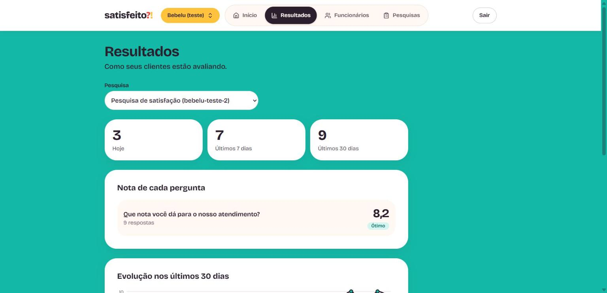
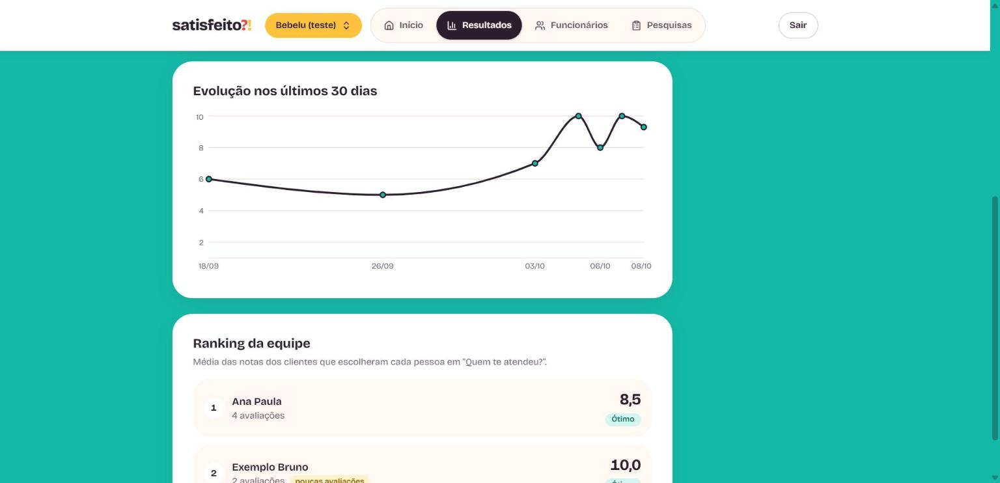

# Satisfeito

> Pesquisa de satisfação simples e rápida para negócios locais — restaurantes, lanchonetes e lojas.

O cliente escaneia um **QR code** na mesa, no balcão ou na nota fiscal, responde em menos de 30 segundos pelo celular, e o dono do negócio acompanha tudo num **painel** com médias, gráficos, ranking dos funcionários e um **resumo escrito por IA** do que os clientes estão dizendo.

O primeiro cliente é a lanchonete **Bebelu**. Depois, a ideia é oferecer o Satisfeito para outros negócios.

> 🚧 **Em desenvolvimento.** Este README é atualizado a cada etapa concluída.

---

## Como vai funcionar

**Para a empresa (com login)**
- Cria conta e entra no painel
- Cadastra funcionários (opcional)
- Monta pesquisas com três tipos de pergunta:
  - **Nota** — escala de 1 a 10
  - **Texto** — resposta livre
  - **Funcionário** — "Quem te atendeu?"
- Gera o link e o QR code da pesquisa
- Acompanha os resultados no painel

**Para o cliente (sem login)**
- Abre a pesquisa pelo QR code, responde e envia — rápido e pensado para celular

**Painel**
- Média de cada pergunta de nota e evolução ao longo do tempo
- Ranking dos funcionários por nota média
- Total de respostas no dia, na semana e no mês
- Respostas recentes
- Resumo com IA: pontos positivos, reclamações e sugestões

---

## Telas

| Página inicial | Entrar |
|---|---|
|  |  |

**Pesquisa que o cliente responde pelo celular** (a página abre pelo QR code, sem login):


**Painel da empresa** (com login):

| Funcionários | Pesquisas |
|---|---|
|  |  |

| Link e QR code da pesquisa | Perguntas da pesquisa |
|---|---|
|  |  |

**Resultados** (totais, nota de cada pergunta, evolução e ranking da equipe):





> Os números desses prints são de exemplo, criados só para a demonstração.

---

## Tecnologias

| Camada | Tecnologia |
|---|---|
| Framework | [Next.js 16](https://nextjs.org) (App Router) + React 19 |
| Linguagem | TypeScript |
| Estilo | Tailwind CSS 4 |
| Banco e login | [Supabase](https://supabase.com) — Postgres + Auth, com RLS (Row Level Security) |
| Gráficos | [Recharts](https://recharts.org) |
| Anti-robô | [Cloudflare Turnstile](https://developers.cloudflare.com/turnstile/) (invisível, sem usar IP) |
| IA | API de IA chamada só pelo servidor *(etapa 7)* |

---

## Progresso

- [x] **Etapa 1** — Estrutura do projeto: Next.js + TypeScript + Tailwind e conexão com o Supabase
- [x] **Etapa 2** — Login e cadastro da empresa
- [x] **Etapa 3** — Cadastro de funcionários (e várias empresas por login)
- [x] **Etapa 4** — Criação de pesquisas e perguntas
- [x] **Etapa 5A** — Página pública da pesquisa, link, QR code e cartaz
- [x] **Etapa 5B** — Proteção contra robôs (Cloudflare Turnstile); a tela para descartar respostas suspeitas vem na Etapa 6
- [x] **Etapa 6A** — Resultados: totais, nota de cada pergunta, evolução e ranking da equipe
- [ ] **Etapa 6B** — Lista de respostas, respostas suspeitas e descarte
- [ ] **Etapa 7** — Resumo com IA
- [ ] **Etapa 8** — Teste real na Bebelu e ajustes

### O que já existe

**Identidade visual satisfeito?!**
- Paleta coral, manga, menta, ameixa e creme; fonte Bricolage Grotesque; ícone `?!` na aba do navegador
- Componentes [shadcn/ui](https://ui.shadcn.com) (Radix) adaptados à marca, com botões e campos pensados para o toque no celular
- Ícones próprios em SVG (sem emojis)

**Conta da empresa**
- Página inicial com "Criar conta" e "Entrar"
- **Cadastro** em uma tela (nome do negócio, e-mail e senha) com confirmação por e-mail
- **Entrar**, **sair** e **esqueci a senha** (link por e-mail → nova senha)
- **Painel** protegido com a saudação da empresa e os primeiros passos
- **Várias empresas por login** (ex.: duas unidades): seletor no topo do painel e "Adicionar empresa"
- Mensagens de erro em português e formulários que não perdem o que foi digitado

**Funcionários**
- Página `/painel/funcionarios`: adicionar em sequência (o campo continua focado), renomear, desativar, reativar e excluir com confirmação
- Nome único por empresa, sem diferenciar maiúsculas ("Ana" e "ana" são o mesmo), com aviso explicando como diferenciar
- Inativos somem da pesquisa, mas o histórico fica guardado
- Funciona pelo teclado e com leitor de tela: o foco nunca se perde, e erros e cadastros são anunciados

**Pesquisas**
- Página `/painel/pesquisas`: lista com o estado de cada pesquisa ("Recebendo respostas" ou "Pausada")
- Criar pesquisa já com perguntas sugeridas: uma nota obrigatória, "Quem te atendeu?" (só se a empresa tiver funcionários ativos) e um comentário livre
- Editor da pesquisa: título editável, Pausar/Retomar e Excluir com confirmação
- Perguntas dos 3 tipos (nota, texto livre e "Quem te atendeu?"), cada uma com ícone próprio: subir/descer, tornar obrigatória/opcional, editar o texto, tirar da pesquisa e devolver depois
- Limite de 10 perguntas e uma só "Quem te atendeu?" por pesquisa, garantidos também no banco
- Avisos quando falta pergunta de nota ("sem nota") ou quando não há funcionários para a pergunta de equipe ("sem equipe")
- Funciona pelo teclado e com leitor de tela

**Resultados**
- Página `/painel/resultados`: uma pesquisa por vez, com seletor quando a empresa tem mais de uma (a pesquisa mais recente com respostas abre primeiro)
- Totais de respostas: hoje, últimos 7 dias e últimos 30 dias (no horário de São Paulo)
- Nota média de cada pergunta, sempre com número e palavra ("Ótimo", "Pode melhorar", "Ruim"), nunca só cor
- Gráfico da nota média por dia nos últimos 30 dias (eixo de tempo real), com tabela escondida para leitor de tela
- Ranking da equipe pela nota média dos clientes que escolheram cada pessoa; quem tem menos de 3 avaliações aparece depois, com a etiqueta "poucas avaliações"
- Respostas descartadas não entram em nenhum número; pesquisa sem respostas mostra como receber a primeira
- Os números saem de uma função do banco (`resultados_pesquisa`, `security invoker`), então o RLS vale: cada empresa só vê a própria pesquisa

**Página pública, link e QR code**
- Cada pesquisa tem um link próprio (`/p/<slug>`), com o slug sugerido a partir do nome da empresa e editável (único no sistema; se já existir, a tela avisa)
- No editor: copiar o link, baixar o QR code em SVG e abrir um cartaz pronto para imprimir
- Página do cliente pensada para o celular: nota de 1 a 10, texto livre e "Quem te atendeu?", com tela de agradecimento
- Pesquisa pausada mostra um aviso em vez do formulário
- O envio passa por uma Server Action que usa a chave secreta só no servidor; o banco valida tudo de novo (pergunta da pesquisa, nota inteira de 1 a 10, funcionário ativo da mesma empresa, obrigatórias)
- Pesquisa ou funcionário com respostas não podem ser excluídos (pausar ou desativar em vez disso)
- **Proteção contra respostas falsas:** tempo mínimo de 3 segundos, marca "já respondeu hoje" no navegador e um teste invisível do Cloudflare Turnstile. O servidor confere o resultado com a Cloudflare antes de gravar; se a verificação falhar, a resposta não é aceita. **Nenhum sinal por IP é usado**, porque o Wi-Fi do local é compartilhado e isso atrapalharia clientes reais

**Segurança**
- Coluna `respostas.descartada`: o dono pode descartar respostas suspeitas das próprias pesquisas (e só mexer nessa coluna); a tela chega na Etapa 6
- Tabelas `respostas` e `respostas_itens`: só o dono da empresa lê; o público nunca lê. A leitura pública da pesquisa passa pela função `pesquisa_publica` (devolve só o necessário) e a gravação pela função `registrar_resposta`, que só o servidor consegue chamar
- Tabela `empresas` criada automaticamente no cadastro (trigger no banco) e protegida por **RLS**: cada conta só vê e edita as próprias empresas; visitante sem login não vê nada
- Tabela `funcionarios` também com **RLS**: o dono só mexe nos funcionários das próprias empresas, e ninguém consegue mover um funcionário para outra empresa
- Tabelas `pesquisas` e `perguntas` também com **RLS**: o dono só mexe nas próprias; o tipo da pergunta, a pesquisa e a empresa não mudam depois de criados; pergunta não se exclui, se arquiva; a troca de ordem é atômica, numa função `security invoker`
- Sessão em cookies verificada no servidor (`getClaims`), renovada por um *proxy* que também bloqueia páginas para quem não está logado
- Proteção contra redirecionamento para sites falsos, cabeçalhos de segurança (anti-clickjacking etc.) e validação de todos os formulários no servidor com [zod](https://zod.dev)

**Testes**
- 84 testes automáticos com [Vitest](https://vitest.dev) (validações, redirecionamento seguro, faixas de nota, escolha da empresa atual, slug, formulário de resposta, Turnstile, apresentação dos resultados)
- Testes de segurança do banco em `supabase/tests/` (`rls_empresas.sql`, `rls_funcionarios.sql`, `rls_pesquisas.sql`, `rls_respostas.sql` e `rls_resultados.sql`), que provam o isolamento entre empresas

---

## Rodando localmente

**Pré-requisitos:** Node.js 20 ou mais recente e um projeto no Supabase.

```bash
# 1. Instale as dependências
npm install

# 2. Crie o arquivo de variáveis de ambiente
cp .env.example .env.local
#    e preencha com a URL e a chave publicável do seu projeto
#    (Supabase > Project Settings > API Keys)

# 3. Rode o servidor de desenvolvimento
npm run dev
```

Abra [http://localhost:3000](http://localhost:3000).

### Variáveis de ambiente

| Variável | Para que serve |
|---|---|
| `NEXT_PUBLIC_SUPABASE_URL` | Endereço do projeto no Supabase |
| `NEXT_PUBLIC_SUPABASE_PUBLISHABLE_KEY` | Chave publicável — pode ir para o navegador, pois quem protege os dados é o RLS |
| `SUPABASE_SECRET_KEY` | Chave secreta, **só no servidor** (nunca com `NEXT_PUBLIC_`): usada para gravar as respostas dos clientes |
| `NEXT_PUBLIC_TURNSTILE_SITE_KEY` | Chave pública do widget Turnstile (Cloudflare). Em desenvolvimento, use as [chaves de teste](https://developers.cloudflare.com/turnstile/troubleshooting/testing/) da Cloudflare |
| `TURNSTILE_SECRET_KEY` | Chave secreta do Turnstile, **só no servidor** |
| `CARIMBO_SEGREDO` | Segredo que assina o carimbo de tempo da pesquisa pública (gere com o comando do `.env.example`) |
| `NEXT_PUBLIC_SITE_URL` | Endereço público do site, usado nos links dos e-mails (em desenvolvimento: `http://localhost:3000`) |

### Configuração do Supabase

1. **Banco:** aplique os arquivos de `supabase/migrations/` em ordem (pelo SQL Editor ou pela CLI do Supabase).
2. **Authentication → URL Configuration:** *Site URL* `http://localhost:3000` e, em *Redirect URLs*, `http://localhost:3000/**`.
3. **Authentication → Sign In / Providers → Email:** "Confirm email" ligado e senha mínima de **8** caracteres.

> No plano gratuito, o Supabase só envia e-mails para os membros da equipe do projeto, poucos por hora, e os modelos de e-mail não podem ser editados. Para produção será configurado um serviço de e-mail próprio (SMTP).

O `.env.local` **nunca** vai para o git (está no `.gitignore`). Chaves secretas, como a `service_role` ou a da IA, nunca levam o prefixo `NEXT_PUBLIC_` e nunca são usadas no navegador.

### Comandos

| Comando | O que faz |
|---|---|
| `npm run dev` | Servidor de desenvolvimento |
| `npm run build` | Gera a versão de produção (também checa os tipos) |
| `npm run start` | Roda a versão de produção |
| `npm run lint` | Procura problemas no código com o ESLint |
| `npm test` | Roda os testes automáticos (Vitest) |
| `npm run test:watch` | Roda os testes de novo a cada arquivo salvo |

---

## Estrutura de pastas

```
src/
├── proxy.ts                  # Roda antes de cada página: renova a sessão e protege rotas
├── app/                      # Páginas e rotas (App Router)
│   ├── layout.tsx            # Layout base (fonte, idioma)
│   ├── page.tsx              # Página inicial
│   ├── (auth)/               # Telas de conta (o grupo não aparece no endereço)
│   │   ├── actions.ts        # Server Actions: entrar, cadastrar, esqueci/redefinir senha
│   │   ├── entrar/  cadastro/  esqueci-senha/  redefinir-senha/
│   ├── auth/confirm/         # Recebe o clique no link do e-mail e cria a sessão
│   └── painel/               # Área logada (menu e seletor de empresa)
│       ├── empresas/         # Trocar e adicionar empresa
│       ├── funcionarios/     # Lista, formulário e ações dos funcionários
│       ├── pesquisas/        # Lista, ações, editor (`[id]/`) e cartaz das pesquisas
│       ├── resultados/       # Totais, notas, gráfico e ranking da equipe
│   └── p/[slug]/             # Página pública da pesquisa (cliente, sem login)
├── components/
│   ├── ui/                   # Componentes do shadcn/ui adaptados à marca
│   ├── marca/                # Logo satisfeito?!
│   ├── icones/               # Ícones próprios em SVG
│   └── formulario/           # Peças de formulário (mensagem de erro)
└── lib/
    ├── auth/                 # Validações (zod), mensagens de erro, redirecionamento seguro
    ├── empresas/             # Qual empresa está aberta no painel
    ├── funcionarios/         # Validação do nome do funcionário
    ├── notas/                # Faixas de nota (boa / atenção / ruim)
    ├── respostas/            # Validação e montagem do envio do cliente
    ├── resultados/           # Tipos e formatação dos números da página Resultados
    ├── pesquisas/            # Validações, perguntas sugeridas e rótulos dos tipos
    └── supabase/             # Clientes do Supabase, proxy e tipos do banco
supabase/
├── migrations/               # SQL do banco (tabelas, RLS, trigger)
└── tests/                    # Testes de segurança do RLS
docs/                         # Desenho, plano e identidade visual de cada etapa
```

---

## Segurança

- Cada empresa só acessa os próprios dados, garantido no **banco** por regras de RLS, e não só na interface
- O público (cliente sem login) só pode ler pesquisas ativas e enviar respostas — nunca ler respostas
- Segredos ficam apenas em variáveis de ambiente no servidor

---

## Licença

Distribuído sob a licença [MIT](LICENSE).

Feito por **Caio Portela**.
